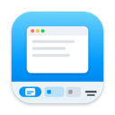

  

<table><tr><td>

**For Discord**

 &nbsp;<b><a href="https://pratherbytecraft.com/discrub">Discrub</a></b> &nbsp;Search, export and bulk delete your own Discord messages, in your browser.   &nbsp;<b><a href="https://pratherbytecraft.com/retrostat">Retrostat</a></b> &nbsp;Reports on who posted, who was mentioned and what was busiest, for any date range.   &nbsp;<b><a href="https://pratherbytecraft.com/scour">Scour</a></b> &nbsp;Deletes messages by rule, any age, and leaves a receipt.   &nbsp;<b><a href="https://pratherbytecraft.com/vested">Vested</a></b> &nbsp;Timed roles that expire on their own.

</td></tr></table>

<table><tr><td>

**For your Mac**

 &nbsp;<b><a href="https://pratherbytecraft.com/startbar">Startbar</a></b> &nbsp;A taskbar along the bottom of the screen with a Start button, one button per window and a clock.   &nbsp;<b><a href="https://pratherbytecraft.com/filedrawer">Filedrawer</a></b> &nbsp;A file manager with tabs, two panes and an address bar, in place of Finder's folder windows.   &nbsp;<b><a href="https://github.com/pratherbytecraft/ClipShot">ClipShot</a></b> &nbsp;A menu bar app that lists your recent screenshots so you can copy or drag them.

</td></tr></table>

<table><tr><td>

**Packages**

 &nbsp;<b><a href="https://www.npmjs.com/package/discrub-core">discrub-core</a></b> &nbsp;The library behind Discrub: Discord API access, message formatting, and the export pipeline.   &nbsp;<b><a href="https://www.npmjs.com/package/drip-fs">drip-fs</a></b> &nbsp;Streaming downloads for web apps and browser extensions that keep memory use flat.

</td></tr></table>

<table><tr><td>

**Custom work**

Websites, apps, tools and automations, built and hosted by Prather Bytecraft. A limited number of projects at a time. Email [workbench@pratherbytecraft.com](mailto:workbench@pratherbytecraft.com) or see the working demos at [demos.pratherbytecraft.com](https://demos.pratherbytecraft.com/?src=github).

</td></tr></table>
